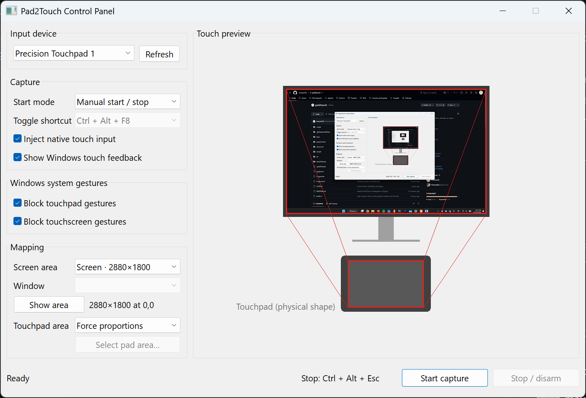

# Pad2Touch

**Map a Windows Precision Touchpad to native touch input.**

Pad2Touch reads finger positions through Windows Raw Input and injects up to five simultaneous contacts at corresponding desktop coordinates. It runs in user mode without a custom driver or changes to the target app.

> **Experimental.** Settings reset between launches.



## Features

- Map all or part of the touchpad to a display, screen region, or application window. Window mappings follow the target as it moves or resizes.
- Start and stop capture in the GUI, or use a global Toggle shortcut or Alt Hold.
- Use the built-in **Test area** to see individual touch trails and a two-finger scaling preview.

## Requirements

- Windows 11. Hardware testing on Windows 10 (1703 or later) is pending.
- A Windows Precision Touchpad on an x64 or ARM64 PC.

Gesture blocking and restoration passed testing on **Windows 11 26H2 (build `26300.9974`)**. Testing on earlier builds, including 25H2, is pending. [Gesture compatibility](docs/gui.md#background-guard)

## Getting started

### Download a build

Download `Pad2Touch-windows-amd64.exe` or `Pad2Touch-windows-arm64.exe` for your PC from GitHub Releases. [Releases](https://github.com/mouse233/pad2touch/releases)

For builds between releases, sign in to GitHub and open a successful CI run for `main`. Download the matching ZIP under **Artifacts**, extract it, and run `Pad2Touch.exe`. CI artifacts are available for seven days. [CI builds](https://github.com/mouse233/pad2touch/actions/workflows/ci.yml?query=branch%3Amain+is%3Asuccess)

### Build from source

Install stable Rust with the MSVC toolchain, the Visual C++ build tools, and a Windows SDK for your architecture. From the repository root, build and launch Pad2Touch.

```powershell
cargo build --release --locked
.\target\release\Pad2Touch.exe
```

### Start capture

1. Select your input device and choose a **Screen area** and **Touchpad area**.
2. Click **Start capture**. To stop, click **Stop / disarm** or press **Ctrl+Alt+Esc** if Windows registered the global shortcut.

## Limitations

- Windows routes touches by screen position. A window target must be visible and unobstructed at the point of contact.
- Elevated apps may reject input from a normally launched Pad2Touch.
- Windows can still move the pointer, click, and scroll in response to the same touchpad activity.

## Diagnostics

Run `Pad2Touch.exe --diagnostics` to see capture metrics and write session logs to `artifacts/runs/`. Pad2Touch has no telemetry. Local logs may contain device paths, so review them before sharing. Gesture recovery files live under `%LOCALAPPDATA%\Pad2Touch\recovery`. [GUI diagnostics](docs/gui.md#diagnostics-and-system-gestures)

After building from source, run the probe script to list detected touchpads.

```powershell
.\scripts\Run-Pad2Touch.ps1 -Mode probe
```

## Development

```powershell
cargo test --locked
cargo clippy --all-targets --locked -- -D warnings
cargo fmt -- --check
```

Default tests never open windows or inject input. See the [testing guide](docs/testing.md) for hardware tests and log analysis.

## Documentation

- [GUI guide](docs/gui.md)
- [Architecture](docs/architecture.md)
- [Testing](docs/testing.md)
- [Background capture & gesture suppression research](docs/background-gesture-feasibility.md)
- [Technical whitepaper](docs/Pad2Touch.md)

## Acknowledgments

- **Tapview** served as a technical reference for Windows Raw Input and HID parsing. [Repository](https://github.com/JohnAZoidberg/tapview)
- **windows-rs** provides the `windows-sys` bindings. [Repository](https://github.com/microsoft/windows-rs)

See the [third-party notices](docs/third-party-notices.md).

## License

Pad2Touch is released under the [MIT License](LICENSE).
